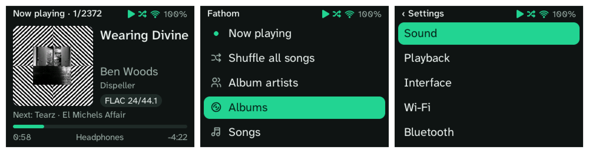
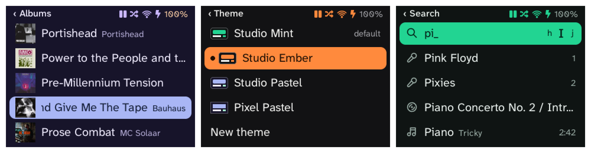
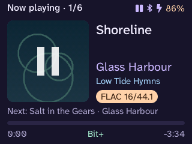
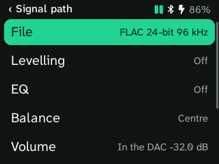

# Fathom

Latest version: [0.20.0](https://github.com/raparc0r/fathom-h2/releases/tag/v0.20.0) released November 25th 2026

[Features](#features) · [Compatibility](#compatibility) · [Installing](#installing) · [Navigation](#navigation) · [Licence](#licence) · [How it was made](#how-it-was-made)

Fathom is a new firmware for the HiFi Walker H2. I started it as a side project with
Claude, just for myself, but it grew into a pretty full-featured firmware, so I'm sharing
it in case anyone is interested. It has working Bluetooth, though the most interesting
discovery was that the H2 actually has a Wi-Fi chip (2.4 GHz only). It's wired, the stock
firmware and Rockbox just don't use it. Fathom uses it for copying music, internet radio,
podcasts and updates, and offers SSH over Wi-Fi and USB.

Fathom is not a Rockbox port. Its bootloader is built on Rockbox's, with Fathom's patches
on top, but the kernel, system and player are Fathom's own. The stock firmware stays on
the H2, so you can go back to it any time. The Rockbox port for the H2 was instrumental in
sorting out the hardware, though. Rockbox is a great project, and if you haven't tried it,
I recommend you check it out: [rockbox.org](https://www.rockbox.org).

## Features

- **First H2 firmware with Wi-Fi.** Fathom enables the Wi-Fi chip in the H2!
- **Over 20 hours of play time.**
- **Easy to install, and to undo.** You copy it to the card and run the H2's own firmware
  update. The stock firmware stays, and Settings → About → Uninstall Fathom puts the H2
  back on it completely, from the H2 itself.
- **Bit-perfect playback.** Pure mode turns off everything that could change the sound.
- **Gapless playback**, so live albums and mixes play without breaks.
- **Most formats**: FLAC, MP3, AAC, ALAC, WAV, AIFF, WavPack, APE, TTA, Opus, Ogg Vorbis
  and DSD, and albums ripped as one file with a CUE sheet.
- **Internet radio.** You can search and browse thousands of stations on the H2 itself,
  with their logos.
- **Podcasts.** Find shows on the H2, or import them from another app, each with its
  picture; new episodes download while it charges.
- **Smart playlists.** Never played, On repeat, Not heard in a while, Forgotten favourites,
  Often skipped.
- **A network drive**, so you can copy music to the H2 over Wi-Fi while it plays.
- **Bluetooth headphones** (SBC and aptX), and their buttons work.
- **USB DACs.** The H2 can play through one, or be your computer's sound card.
- **A parametric EQ.** Load your headphones' profile from AutoEQ, or make your own on the
  H2. Each output remembers its own.
- **Stereo width**, from mono to twice as wide.
- **A better shuffle.** It spreads songs across artists and albums, and plays what you
  haven't heard in a while first.
- **Themes**: use one of the four built-in themes, or make your own on the H2 itself.
- **Customizable home screen.** Show/hide and reorder entries such as Composers, Genres...
- **Missing album covers**, found online and saved on the card, never in your music
  folder.
- **Lots of ways to browse**: artists, albums, genres, composers, years, folders,
  playlists, favourites, history and search.
- **Volume levelling**, from ReplayGain tags, or measured on the H2 when tags are missing.
- **Battery history**, a sleep timer and automatic power-off.
- **Updates over Wi-Fi.** It tells you when a new version is out.
- **SSH and SFTP**, if you like to poke around (off by default).

| | | |
|---|---|---|
|  |  |  |

## Compatibility

Fathom is only compatible with the HiFi Walker H2 revision 4, sold from 2023. Older H2s aren't
supported, and the installer won't run on them. Fathom is free software with no warranty,
tested on one H2, but it's hard to break: the H2 can always be recovered from a computer.

## Installing

You'll need a microSD card formatted FAT32, the H2 charged above 50 %, and the latest
`fathom-h2-VERSION.zip` from [Releases](https://github.com/raparc0r/fathom-h2/releases),
unzipped.

1. Put your music in a folder called `Music` at the top of the card.
2. Copy everything inside the release's `sd/` folder to the top of the card.
3. Put the card in the H2 and, in the stock firmware, choose **System Settings → Firmware
   Update**. The H2 restarts into Fathom, which reads your library. (If your H2 has
   Rockbox, hold **Vol+** while turning it on and choose **Boot select → HibyOS Recovery**
   instead: [INSTALL.md](INSTALL.md) says why.)

Once Fathom is installed, hold **Play** while turning the H2 on to start the stock
firmware instead. To remove Fathom, bootloader included: in Fathom, Settings → About →
**Uninstall Fathom** ([GUIDE.md](GUIDE.md)).

More: [INSTALL.md](INSTALL.md) (the full steps, and a recommended backup),
[GUIDE.md](GUIDE.md) (using Fathom, and uninstalling it), [ADVANCED.md](ADVANCED.md)
(recovery, SSH, building it yourself).

## Navigation

| Key | Press | Hold |
|---|---|---|
| Wheel | move through a list | |
| Play | choose; on Now Playing, play or pause | |
| Back | go back | jump to Now Playing, and back |
| Menu | options for what's selected (shuffle an album or an artist, play next, add to a playlist, go to the album...) | quick settings: brightness, shuffle, repeat, EQ, stereo width, Bluetooth, Wi-Fi, sleep timer |
| Menu + wheel | | brightness: hold Menu and turn the wheel |
| Prev / Next | previous or next track | seek |
| Power | screen off or on | switch off (2 seconds) |

With the screen off, Play, Prev, Next and the volume keys still work. In Settings, **Menu**
on any setting says in a line or two what it does. More in [GUIDE.md](GUIDE.md).

## Licence

Fathom is GPL-3.0-or-later. The bootloader, being Rockbox's, is GPL-2.0-or-later (with
the scripts that build it and the logo it shows), and the Linux kernel patches are
GPL-2.0-only. The full texts are in [LICENSE](LICENSE). The fonts
come with their own licences (SIL Open Font License; the icons are MIT). The screenshots
show a made-up library.

The GPL-3.0 parts come with a few additional terms, as the GPL's section 7 allows: keep the
credit "Fathom by m11n/raparc0r" (or "Based on Fathom by m11n/raparc0r") in About, mark a
changed version as changed, and give a fork a name of its own. They're at the top of [LICENSE](LICENSE).

Fathom isn't affiliated with HiFi Walker, AIGO or HiBy.

## How it was made

All of Fathom's code was written by Claude, Anthropic's AI. The decisions were mine: which
features to build and how they should work, the interface and how it looks, and what was
good enough to ship. Getting here took many rounds of revisions, and a lot of testing on
the H2 itself.
