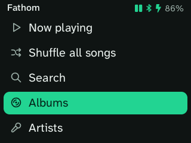

# Fathom

Latest version: [0.11.0](https://github.com/raparc0r/fathom-h2/releases/tag/v0.11.0) released November 19th 2026

[Features](#features) · [Compatibility](#compatibility) · [Installing](#installing) · [Internet access](#internet-access) · [Licence](#licence) · [How it was made](#how-it-was-made)

Fathom is a new firmware for the HiFi Walker H2. I started it as a side project with
Claude, just for myself, but it grew into a full-featured firmware, so I'm sharing it. It
has its own kernel, system and player, built from source; the bootloader is built on
Rockbox's, with Fathom's patches on top. The stock firmware stays on the H2, so you can go
back to it any time. The most interesting discovery along the way: the H2 has a Wi-Fi
chip, which Fathom uses for internet radio, copying music and updates.

The Rockbox port for the H2 was a huge help in sorting out the hardware. Rockbox is a great
project, and if you haven't tried it, check it out: [rockbox.org](https://www.rockbox.org).

| | | | |
|---|---|---|---|
|  |  |  |  |

## Features

- **First H2 firmware with Wi-Fi.** Fathom enables the Wi-Fi chip in the H2!
- **Over 20 hours of play time.**
- **Easy to install, and to undo.** You copy it to the card and run the H2's own firmware
  update. The stock firmware stays, and Settings → About → Uninstall Fathom puts the H2
  back on it completely, from the H2 itself.
- **Bit-perfect playback.** Pure mode turns off everything that could change the sound.
- **Gapless playback**, so live albums and mixes play without breaks.
- **Most formats**: FLAC, MP3, AAC, ALAC, WAV, AIFF, WavPack, APE, TTA, Opus, Ogg Vorbis
  and DSD, and albums ripped as one file with a CUE sheet.
- **Internet radio.** You can search and browse thousands of stations on the H2 itself.
- **A network drive**, so you can copy music to the H2 over Wi-Fi while it plays.
- **Bluetooth headphones** (SBC and aptX), and their buttons work.
- **USB DACs.** The H2 can play through one, or be your computer's sound card.
- **A parametric EQ.** Load your headphones' profile from AutoEQ, or make your own on the
  H2. Each output remembers its own.
- **A better shuffle.** It spreads songs across artists and albums, and plays what you
  haven't heard in a while first.
- **Themes**, use one of the four default themes or make your own.
- **Lots of ways to browse**: artists, albums, genres, composers, years, folders,
  playlists, favourites, history and search.
- **Volume levelling**, from ReplayGain tags, or measured on the H2 when tags are missing.
- **Battery history**, a sleep timer and automatic power-off.
- **Updates over Wi-Fi.** It tells you when a new version is out.
- **SSH and SFTP**, if you like to poke around (off by default).

| | | |
|---|---|---|
|  |  |  |

## Compatibility

Fathom is only compatible with he HiFi Walker H2 revision 4, sold from 2023. Older H2s aren't
supported, and the installer won't run on them. Fathom is free software with no warranty,
tested on one H2, but it's hard to break: the H2 can always be recovered from a computer.

## Installing

You'll need a microSD card formatted FAT32, the H2 charged above 50 %, and the latest
`fathom-h2-VERSION.zip` from [Releases](https://github.com/raparc0r/fathom-h2/releases),
unzipped.

1. Put your music in a folder called `Music` at the top of the card.
2. Copy everything inside the release's `sd/` folder to the top of the card.
3. Put the card in the H2 and, in the stock firmware, choose **System Settings → Firmware
   Update**. The H2 restarts into Fathom, which reads your library. (If your H2 runs
   Rockbox, hold **Play** while turning it on to start the stock firmware first.)

To start the stock firmware instead, hold **Play** while turning the H2 on. To remove
Fathom, bootloader included: Settings → About → **Uninstall Fathom** ([GUIDE.md](GUIDE.md)).

More: [INSTALL.md](INSTALL.md) (the full steps, and a recommended backup),
[GUIDE.md](GUIDE.md) (using Fathom, and uninstalling it), [ADVANCED.md](ADVANCED.md)
(recovery, SSH, building it yourself).

## Internet access

Fathom goes online only over Wi-Fi, and by itself only for two things:

- **the time**, from a time server when Wi-Fi connects, because the H2 has no clock that
  keeps running while it's off;
- **updates**, by asking GitHub once a day whether a new version is out. It never
  downloads or installs anything unless you choose to. Settings → About → Check
  automatically turns this off.

Everything else, such as radio and finding stations, connects only when you use it.

## Licence

Fathom is GPL-3.0-or-later. The bootloader, being Rockbox's, is GPL-2.0-or-later, and the
Linux kernel patches are GPL-2.0-only. The full texts are in [LICENSE](LICENSE). The fonts
come with their own licences (SIL Open Font License; the icons are MIT). The screenshots
show a made-up library.

Fathom isn't affiliated with HiFi Walker, AIGO or HiBy.

## How it was made

All of Fathom's code was written by Claude, Anthropic's AI. The decisions were mine: which
features to build and how they should work, the interface and how it looks, and what was
good enough to ship. Getting here took many rounds of revisions, and a lot of testing on
the H2 itself.
