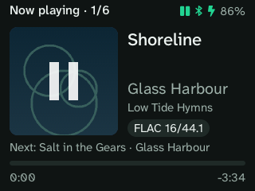
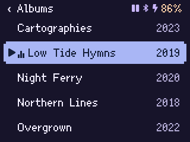
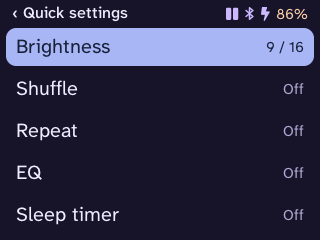
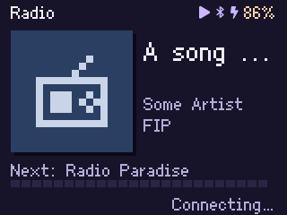
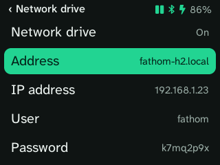

<p align="center"></p>

# Fathom

Fathom is a new firmware for the HiFi Walker H2. I started it as a side project with
Claude, just for myself, but it grew into a pretty full-featured firmware, so I'm sharing
it. It has its own kernel, system and player, built from source; the bootloader is built on
Rockbox's, with Fathom's patches on top. The stock firmware stays on the H2, so you can go
back to it any time.

| | | | |
|---|---|---|---|
|  |  |  |  |

Bluetooth works, but the most interesting discovery was that the H2 actually has a Wi-Fi
chip. Fathom uses it for internet radio and for copying music over the network, and it
could be used for streaming from Plex and other servers later. There's also SSH over Wi-Fi
and USB.

The Rockbox port for the H2 was a huge help in sorting out the hardware. Rockbox is a great
project, and if you haven't tried it, check it out: [rockbox.org](https://www.rockbox.org).

## Features

- Easy install, and easy to undo
- Bit-perfect playback, with Pure mode to make sure nothing touches the sound (Now Playing
  shows "Bit+" under the progress bar while it's bit-perfect), and a screen that shows the
  whole signal path
- FLAC, MP3, AAC, ALAC, WAV, AIFF, WavPack, APE, TTA, Opus, Ogg Vorbis and DSD (DSF/DFF),
  plus albums ripped as one file with a CUE sheet
- The H2 as a transport for a USB DAC/amp, or as a USB DAC for your computer
- Bluetooth headphones (SBC and aptX), with their buttons
- Internet radio, with thousands of stations to find and search on the H2
  ([radio-browser.info](https://www.radio-browser.info)), and your music as a network
  drive over Wi-Fi (WebDAV over HTTPS)
- Updates over Wi-Fi, when you ask for them
- A parametric EQ: import AutoEQ profiles or make your own on the H2, saved per output,
  along with balance and a volume limit
- A better shuffle: not just random songs, but one that feels random to a person (spread
  across artists and albums, unheard songs first, short interludes skipped)
- Large, easy-to-read type and a customisable home screen; four themes, or make your own
- Browse by artist, album, genre, composer, year or folder; playlists, favourites, history
  and search; volume levelling from ReplayGain tags or measured on the H2
- Sleep timer, battery time left, and Fathom in other languages if someone translates it
- SSH and SFTP over USB and Wi-Fi (off by default, password protected)

| | | |
|---|---|---|
|  |  |  |

## Which H2

It works on the current H2 (hardware revision 4, sold from 2023). In the stock firmware,
System Settings → About the player → Version should say something between V1.9 and V2.3.
Older H2s aren't supported, and the installer won't run on them.

I've only tested it on my own H2. It's free software with no warranty, so install it at
your own risk. That said, it's hard to break: the H2's chip has a USB boot mode that can't
be overwritten, so you can always get back in from a computer (see below).

## Installing

You'll need a microSD card formatted FAT32 (exFAT won't work), and the latest
`fathom-h2-VERSION.zip` from Releases, unzipped. Charge the H2 above 50 % first.

1. Put your music in a folder called `Music` at the top of the microSD card (subfolders
   inside it are fine). Fathom only looks there: music anywhere else on the card won't
   show up in the library. If your music is at the top of the card or in a folder with
   another name, move it into `Music` first.
2. Copy everything inside the release's `sd/` folder to the top of the microSD card. The
   release's other folders are for recovery (`recovery/`) and reference (`about/`).
3. Put the card in the H2, turn it on as usual and go to System Settings → Firmware Update.
   The H2 installs Fathom's bootloader and restarts into Fathom, which then reads your
   library (a few minutes the first time). That's the only thing that's written to the H2
   itself, and it's 128 KiB. You can delete `update.upt` afterwards.
4. Optional but a good idea: make a backup of your H2. Turn it off, hold Vol+ while turning
   it on, and choose Debug tools → Dump entire flash. After a few minutes you'll have a
   `flash.img` on the card. Keep it somewhere safe and don't share it, since it has your
   H2's factory data in it.

The first time it starts, Fathom copies the Bluetooth and Wi-Fi firmware from the stock
system into its own folder. Fathom can't distribute those files, but every H2 already has
them.

To update Fathom later, go to Settings → About → Check for updates (from 0.8.0 on, with
Wi-Fi), or copy the new `sd/` folder over the old files.

## Using it

Most of it should feel familiar. A few things worth knowing:

- Menu opens options for whatever is selected. Holding Menu opens quick settings
  (brightness, shuffle, repeat, EQ, sleep timer...). Holding Back jumps to Now Playing and
  back.
- To add music, plug the H2 into a computer, choose "Use as a USB drive" and copy it into
  the `Music` folder. Choose "Use as a USB DAC" instead to use it as your computer's sound
  card.
- Hold Play while turning it on to start the stock firmware instead.
- With the screen off, play/pause, previous/next and volume still work.
- For the network drive, turn it on in Settings, then connect to `https://fathom-h2.local`
  with the user and password the screen shows. The H2 makes its own certificate, so the
  first time your computer will ask whether to trust it; check the fingerprint matches the
  one on the screen. On a Mac it's Finder → Go → Connect to Server. On Windows you need to
  install the certificate first (open the address in a browser and save it into "Trusted
  Root Certification Authorities"), then Map network drive.
- Fathom doesn't contact anything on the internet by itself, except a time server when
  Wi-Fi connects (the H2 has no clock that keeps running while it's off, and secure
  connections need the date). Everything else happens only when you ask: radio, finding
  stations, checking for updates.
- SSH is off until you turn it on in Settings: `ssh root@10.42.0.1` over the USB cable, or
  the Wi-Fi address shown, with the password on the screen. Your music is in
  `/mnt/sd/Music`.



## The fathom folder

Fathom keeps its settings, library and cover cache in a `fathom` folder on the microSD
card, and that's also where you put things to customise it:

- `radio.txt` for your own radio stations, one per line as `Name = URL`. The URL can be the
  stream itself or the station's `.m3u`, `.pls` or `.m3u8` link. Stations you add from
  Home → Radio → Find stations go here too.
- `eq/` for EQ profiles. Get your headphones' `ParametricEQ.txt` from
  [AutoEQ](https://autoeq.app) (pick "Equalizer APO") and drop it in, then choose it in
  Settings → Sound → EQ.
- `themes/` for your own themes: colours, shapes, fonts and icons. [THEMES.md](THEMES.md)
  explains every option; the built-in ones in `assets/themes/` are good to start from.
  Restart the H2 to see a new one in Settings → Theme.
- `lang/` for translations: a `Language.txt` file with one `English text = translation` per
  line. Anything not translated stays in English.
- `keys/authorized_keys` if you'd rather log in to SSH with a key.
- `boot-1.log` is the log of the last start (up to `boot-5.log`). Please attach them if you
  report a bug.

Wi-Fi passwords and the network drive and SSH passwords are stored on the card, so anyone
holding it can read them.

## If something goes wrong

If the H2 won't start, you can always load the bootloader from a Mac or Linux computer
with Rockbox's `jztool` (in the release's `recovery/` folder for macOS; on Linux, build it
with `make -C utils/jztool` from [Rockbox's source](https://github.com/Rockbox/rockbox) and
run it with `sudo`):

1. Turn the H2 fully off (hold Power for 10 seconds) with the card in.
2. Plug a USB-C data cable into the H2, hold Menu, plug the other end into the computer,
   and let go. The screen stays black.
3. In the release's `recovery/` folder, run `./jztool erosq load bootloader.erosq`. On a
   Mac, if it's blocked as coming from an unknown developer, run
   `xattr -d com.apple.quarantine jztool` first.
4. The bootloader's menu appears. Boot select → Hiby Player starts the stock firmware,
   Boot select → Linux starts Fathom, and Bootloader → Install or update reinstalls the
   bootloader (copy `recovery/bootloader.erosq` to the top of the card first).

If Bluetooth and Wi-Fi ever say their firmware is missing, hold Vol+ while turning the H2
on and choose Advanced → Copy BT/Wi-Fi firmware.

## Uninstalling

The stock firmware is still there: hold Play while turning the H2 on. To remove Fathom's
bootloader as well, take HiBy's update file for your H2 (the version it had, or newer), add
its bootloader with Rockbox's `hibyos_nativepatcher.sh mkstockuboot`, and put it on the
card as `update.upt`. Then hold Vol+ while turning the H2 on and choose Boot select →
HibyOS Recovery, and HiBy's own updater puts everything back.

## Building it yourself

Everything builds with Buildroot inside Docker:

```bash
docker/run.sh buildroot/build.sh fathom-player-rebuild all   # kernel, system and player
docker/run.sh bootloader/build.sh                           # the bootloader
```

On a Mac, `cmake -S . -B build && cmake --build build` builds the tests and a simulator of
the UI (`build/sim/fathom-sim --music ~/Music`; needs SDL2).

## Licence

Fathom is GPL-3.0-or-later. The bootloader, being Rockbox's, is GPL-2.0-or-later, and the
Linux kernel patches are GPL-2.0-only. The full texts are in [LICENSE](LICENSE). The fonts
come with their own licences (SIL Open Font License; the icons are MIT). The screenshots
show a made-up library.

Fathom isn't affiliated with HiFi Walker, AIGO or HiBy.
